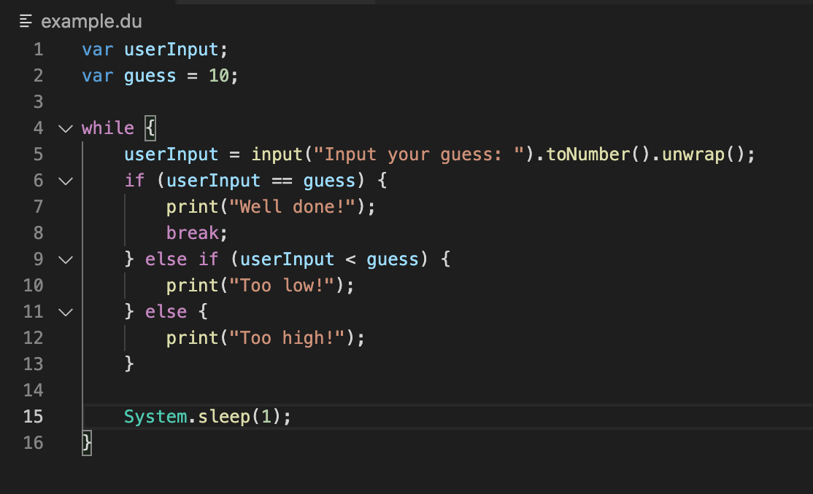
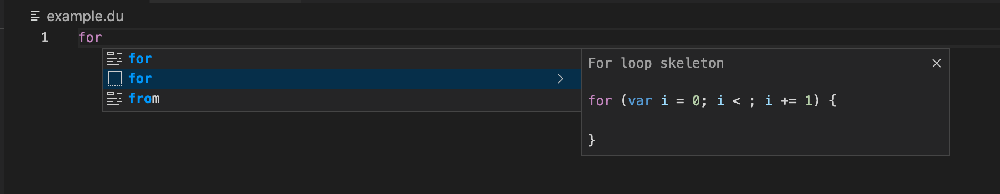
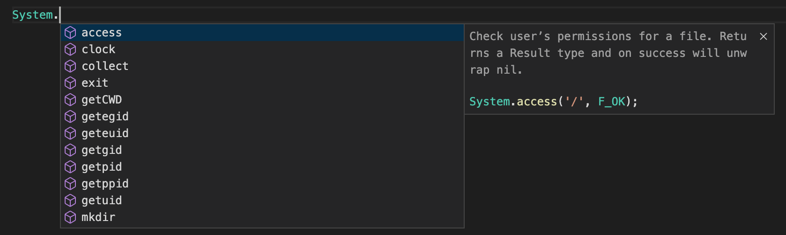

# Dictu Extension

The [Dictu language](https://dictu-lang.com) extension for [VSCode.](https://code.visualstudio.com/)

## Features

### Language Intelligence
- **Syntax Highlighting** — Full TextMate grammar with support for keywords, strings, raw strings, annotations, operators, and more
- **Auto Completion** — Keywords, builtins, all 27 standard library modules, module members, type methods, and code snippets
- **Hover Documentation** — Hover over keywords, builtins, modules, and methods to see documentation
- **Signature Help** — Parameter hints when calling functions
- **Go to Definition** — Click-to-navigate for functions, classes, variables, and imports
- **Find All References** — Find every usage of a symbol across your workspace
- **Rename Symbol** — Rename variables, functions, and classes across the document
- **Document Symbols** — Outline view showing classes, functions, enums, traits, and variables
- **Workspace Symbol Search** — Search symbols across all open Dictu files

### Editor Features
- **Code Folding** — Fold code blocks, multi-line comments, and import groups
- **Document Formatting** — Auto-format with configurable indentation
- **Code Actions** — Quick fixes for common issues (e.g., `= =` to `==`)
- **Diagnostics** — Real-time error detection for mismatched brackets, unterminated comments, and common typos
- **Document Links** — Clickable import paths to navigate between files
- **Document Highlight** — Highlights all occurrences of a symbol in the current file

### Run & Execute
- **Run Dictu File** — Run the current file with `Cmd+Shift+R` (Mac) / `Ctrl+Shift+R` (Windows/Linux)
- **Run Selection** — Run selected code with `Cmd+Shift+Enter` / `Ctrl+Shift+Enter`
- **Status Bar Button** — One-click run button when editing Dictu files
- **Context Menu** — Right-click to run files or selections

### Syntax Highlighting

 
<em>(Syntax highlighting)</em>

### Auto Completion

 
<em>(Auto Completion)</em>

### Documentation

 
<em>(Documentation)</em>

## Configuration

| Setting | Default | Description |
|---------|---------|-------------|
| `dictu.dictuPath` | `"dictu"` | Path to the Dictu executable |
| `dictu.formatOnSave` | `false` | Auto-format on save |
| `dictu.indentSize` | `4` | Spaces per indent level |
| `dictuLanguageServer.maxNumberOfProblems` | `100` | Maximum diagnostics |
| `dictuLanguageServer.trace.server` | `"off"` | Server communication tracing |

## Contributing

See [contributing](contributing.md).

## License

This project is licensed under the MIT license.
